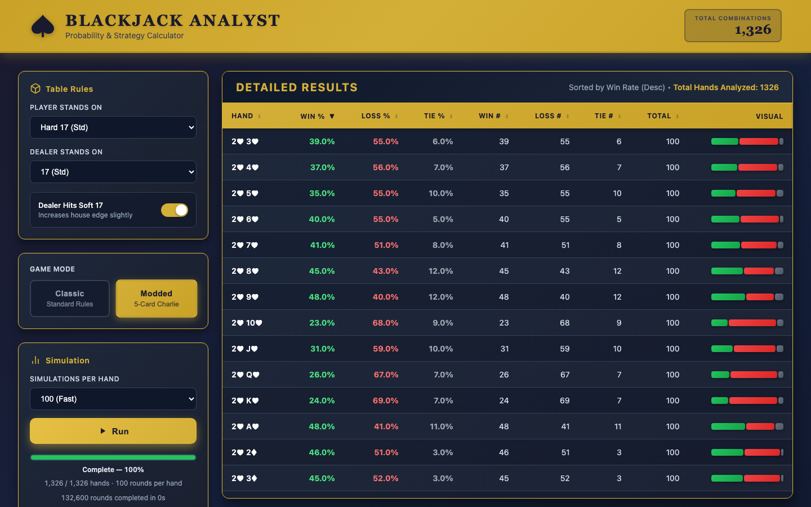

# Blackjack Analyst

[](https://unknown-x0.github.io/Blackjack-Analyst/)
[](https://github.com/UNKNOWN-X0/Blackjack-Analyst/actions/workflows/checks.yml)
[](https://developer.mozilla.org/en-US/docs/Web/JavaScript)

A browser-based Monte Carlo simulator for blackjack starting hands. It estimates win, loss, and tie rates for all **1,326 unique two-card combinations** from a single 52-card deck, using configurable player and dealer hit/stand thresholds.

**[Open Blackjack Analyst →](https://unknown-x0.github.io/Blackjack-Analyst/)** · [Report an issue](https://github.com/UNKNOWN-X0/Blackjack-Analyst/issues)



## Features

- **Every starting combination:** analyze individual cards and suits, not just hand totals.
- **Configurable rules:** adjust player and dealer stand thresholds from 12 to 20 and toggle the dealer's soft-hand behavior.
- **Two modes:** Classic disables Five-Card Charlie; Modded enables it for both player and dealer.
- **Adjustable sample size:** choose 100, 1,000, 10,000, or 100,000 simulations per starting hand, or enter a custom count.
- **Interactive results:** compare percentages with 95% confidence intervals, outcome counts, visual bars, and the best observed starting hand.
- **CSV export:** download summaries grouped by starting total plus results for every individual combination.
- **No build step:** runs in the browser with no runtime dependencies or backend.

## Getting started

### Use it online

Open the [live app](https://unknown-x0.github.io/Blackjack-Analyst/).

### Run it yourself

Clone the repository, then open its folder in VS Code:

```sh
git clone https://github.com/UNKNOWN-X0/Blackjack-Analyst.git
cd Blackjack-Analyst
```

With Microsoft's **Live Preview** extension installed, open `index.html` and use **Live Preview: Show Preview** from the Command Palette.

Alternatively, with Python 3 installed, start a local server from the repository root:

```sh
python3 -m http.server 8000 --bind 127.0.0.1
```

Open [localhost:8000](http://localhost:8000). Stop the server with **Ctrl+C**.

Serve the project over HTTP: opening `index.html` directly as a `file://` URL can block JavaScript module loading. No `npm install` or build command is needed.

## Usage

### Run an analysis

1. Set the player and dealer stand thresholds.
2. Choose **Classic** or **Modded** and set the soft-hand toggle.
3. Select a simulation count. Start with 100 for a quick check.
4. Click **Run** and wait for all starting hands to finish.
5. Click sortable column headers to compare results, then use **Export CSV** to save them.

The defaults are player 17, dealer 17, dealer hits soft 17 enabled, Modded mode, and 1,000 simulations per hand.

### Understanding the model

This is a simulator for **fixed threshold strategies**, not an optimal basic-strategy solver. Player decisions depend on the player's total, not the dealer's upcard.

Each round starts with a freshly shuffled single deck. The selected starting cards are removed, two cards are dealt to the dealer, and the player and dealer draw according to their configured thresholds. Aces count as 1 or 11 to produce the highest non-busting total.

#### Current rule behavior

| Rule | Implementation |
| --- | --- |
| Player threshold | Hit below the selected total; stand at or above it. This applies to hard and soft hands alike. |
| Dealer threshold | Hit below the selected total; stand above it. At the threshold, hit a soft hand when the toggle is enabled. |
| “Dealer Hits Soft 17” toggle | At the default threshold of 17, this means hit soft 17. With another dealer threshold, the toggle applies to a soft hand at that selected total. |
| Classic mode | Compare totals after checking for busts; Five-Card Charlie is disabled. |
| Modded mode | A final hand of five or more cards totaling 21 or less qualifies for Charlie. The player is checked first, before the dealer plays. |
| Charlie timing | Checked after threshold-based drawing finishes; reaching five cards does not itself stop drawing. |
| Natural blackjack | A two-card 21 is treated as a total of 21, with no special priority or payout. |

Outcome checks occur in this order: player bust → player Charlie → dealer bust → dealer Charlie → compare totals. Equal surviving totals tie.

Splitting, doubling down, surrender, insurance, side bets, dealer peeking, multi-deck shoes, and bankroll or payout calculations are not modeled.

### Reading and exporting results

Results are Monte Carlo estimates and vary between runs. Each win rate shows a 95% Wilson confidence interval based on its wins and rounds; increasing the sample size generally narrows the interval but takes longer. The “best” hand has the highest observed win rate in that run. Its card warns when its interval overlaps the runner-up's; that comparison does not prove the hands differ.

The count is **per starting hand**: 1,000 simulations means 1,326,000 rounds in total. At 100,000 per hand, the browser performs 132,600,000 rounds. Large runs can be slow because computation runs on the browser's main thread.

The exported `blackjack-simulation-complete.csv` contains two sections:

| Section | Contents |
| --- | --- |
| Grouped by starting total | Number of combinations, win/loss/tie percentages from the summed counts, 95% win interval bounds, and the summed outcome counts for each total. |
| Detailed hand data | Individual starting cards, win/loss/tie percentages, 95% win interval bounds, counts, and total rounds. |

Grouped percentages are computed from the summed counts of the hands in each group. Hands with the same total can have different compositions; the grouped summary combines them. The export includes section headings and blank separators, so import each section separately when a spreadsheet tool expects a single rectangular table.

## Privacy

Nothing is stored and nothing is sent: simulations run in your browser, and **Export CSV** saves the file to your computer.

## Development

### Hosting

The app is served through GitHub Pages. It is also compatible with other static hosts: publish `index.html`, `styles.css`, and the complete `js/` directory together, preserving their paths. There is no server application or generated build folder.

## Tests

Use Node.js 22 or newer:

```sh
npm test
```

Tests use Node's built-in test runner; no package installation is required. They cover deck and starting-hand combinations, ace handling, threshold behavior, simulation counts, and CSV output.

Keep changes focused on the relevant module. After a change, run the tests and preview the app to check controls, progress, sorting, and CSV download. Use a feature branch and pull request to review changes before merging into `main`.

## Project structure

```text
index.html          Page structure and module entry point
styles.css          Layout, theme, and responsive styling
js/app.js           Events, simulation orchestration, and progress
js/state.js         Settings and current results
js/rules.js         Decks, card values, and hit/stand rules
js/simulation.js    Starting combinations, rounds, and statistics
js/results.js       Table sorting
js/ui.js            Controls, summaries, and table rendering
js/csv.js           CSV generation and download
tests/core.test.js  Core rules, simulation, and CSV checks
.github/workflows/  Repository automation
package.json        ES module setting and test command
assets/preview.png  Screenshot for this README
```

Rules and simulation logic are independent of the DOM. CSV generation is separate from the download action, making the output easier to verify.

## Project documents

| File | What it covers |
| --- | --- |
| [ROADMAP.md](ROADMAP.md) | What is planned next, with an issue per item |

## Contributing

Bug reports and focused pull requests are welcome. For a simulation issue, include the selected rules, mode, sample count, and the behavior you expected. For a UI issue, include your browser and reproduction steps.
